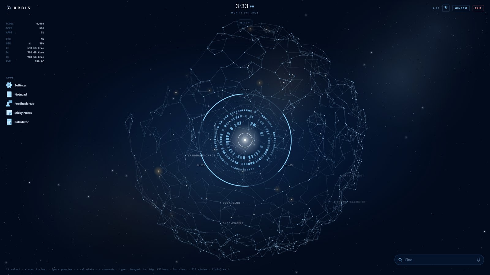
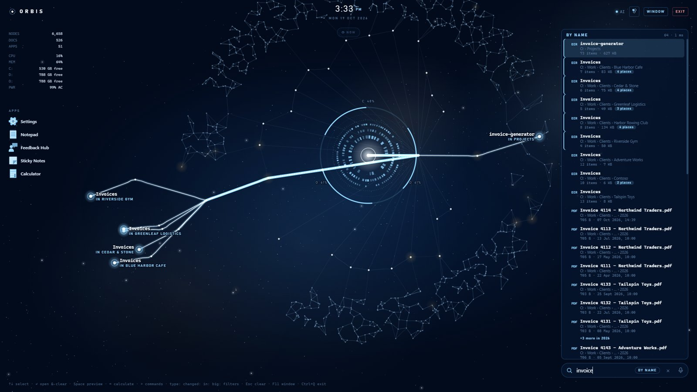
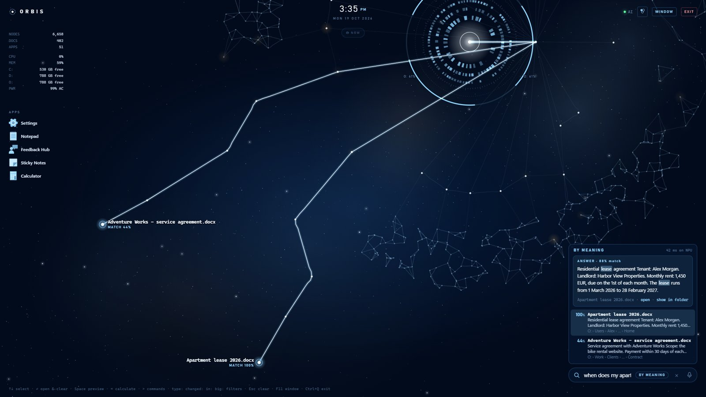
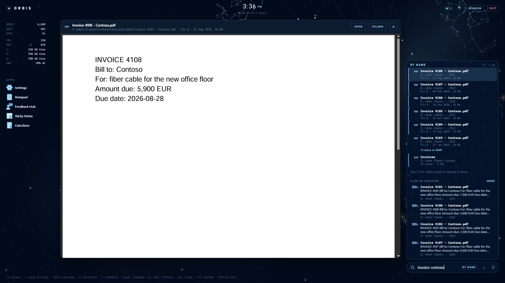
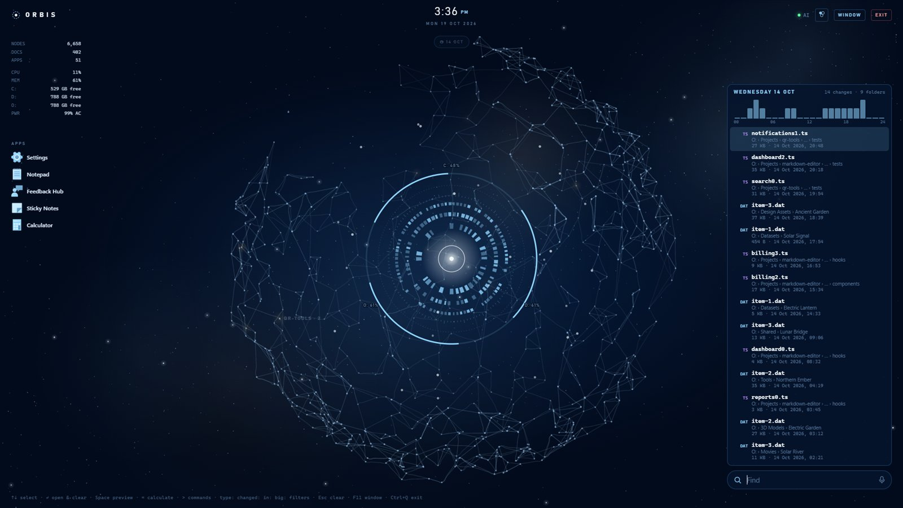
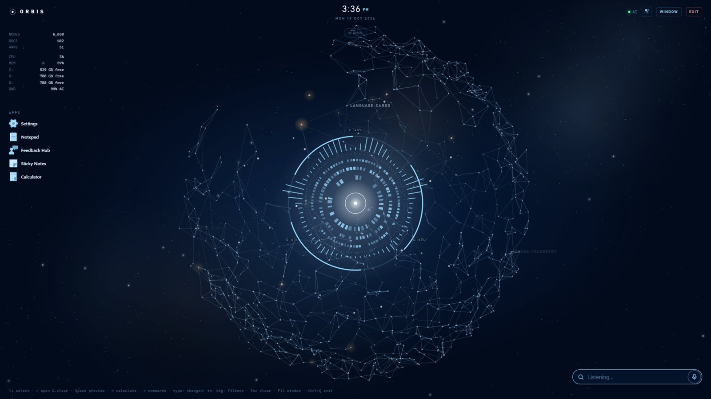
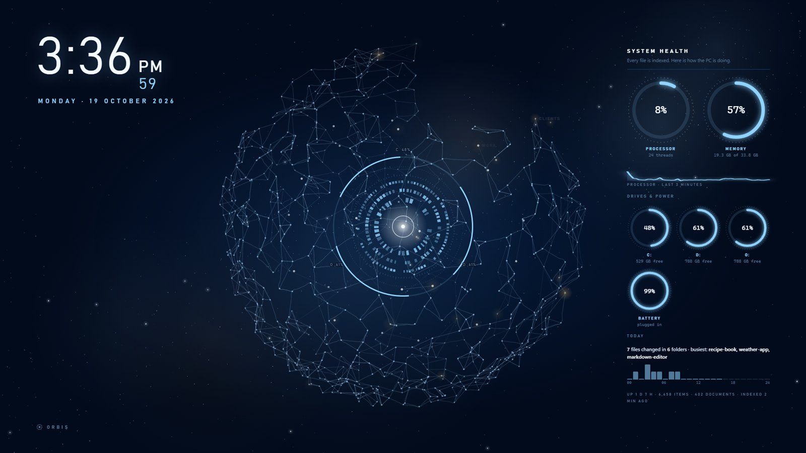
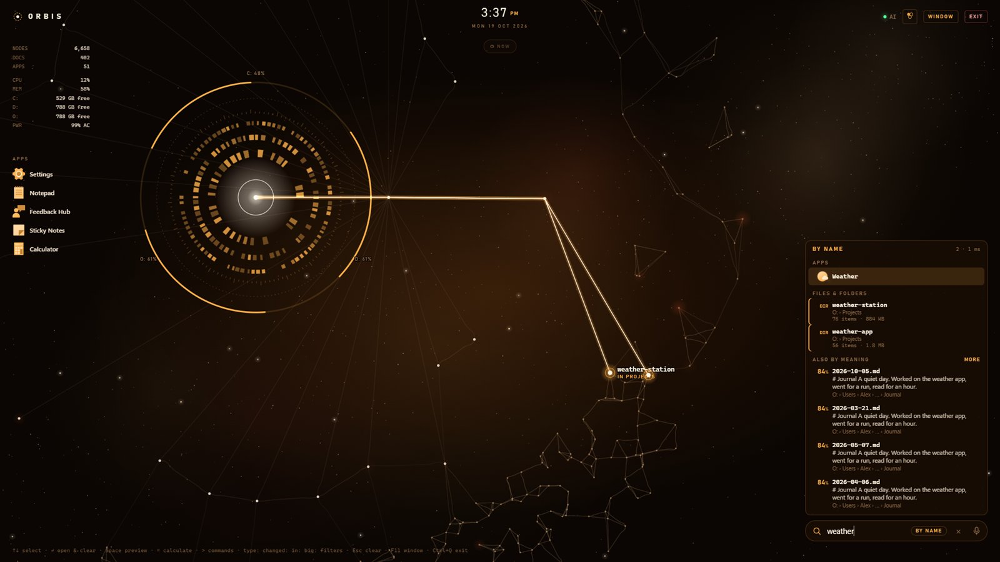

# Orbis

**A neural file explorer and launcher for Windows.** Orbis draws your drives as a living network of
folders, a slowly turning 3D globe, and finds anything on them by name, or by *describing* it
when you don't remember the name. It also launches your apps, answers questions from your documents,
listens to voice commands, does quick sums and runs Windows commands, all from one search box.

Everything runs on your PC. Orbis sends nothing anywhere.



**[⬇ Download Orbis for Windows](https://github.com/NebuByte/Orbis/releases/latest)** · Windows 10 and 11, 64-bit · free and open source (MIT)

## Quick start

1. Download `Orbis_x.y.z_x64-setup.exe` from the [latest release](https://github.com/NebuByte/Orbis/releases/latest).
2. Run it. It installs for your user only, with no administrator rights, in a few seconds.
   Windows may say *"Windows protected your PC"*, because the installer is not code-signed yet:
   click **More info → Run anyway**.
3. Orbis opens, looks at your PC, suggests settings, and maps your drives. Start typing.

The optional extras (search by meaning, voice) are switched on from the palette menu, top right, and
download what they need the first time. Nothing else to install.

## What it does

### Find anything, by name

Every file and folder on your drives, searched as you type in a few milliseconds. The globe unfolds
and glowing lines run from the core to every result. Copies of the same item are merged into one
result, and build output and tool caches rank lower.



### Ask your documents

Describe a document (*"the order for the fiber cable from last year"*) and Orbis finds it by what's
inside, in English, Arabic and about 100 other languages. Ask a question (*"when does my lease end?"*)
and it shows the passage that answers it. This runs on your PC's **NPU** when it has one (Intel AI
Boost), otherwise on the Intel GPU or the processor.



### Space to preview

Move to a result with the arrows and press Space: pictures, PDFs, video, text and code, Word, Excel
and PowerPoint, or a folder's contents, right inside Orbis. The arrows flip through results while it is open.



### Time travel

A slider under the clock goes back up to 60 days: the globe glows where files changed that day, the
busiest folders are named, and the day's files are listed with a chart of changes per hour.



### Voice: Orbis listens

Push-to-talk with **Ctrl+Alt+Space** from anywhere (or the mic in the search box), or just say
**"Orbis"** while it is open. While it listens, the core moves with your voice. "Open Spotify", "lock
the PC", "restart" (it asks you to say yes), "dark theme", "find the invoice from March": anything else
goes to the search box as if you typed it. English and Arabic.

Speech is turned into words on your PC (Whisper small with OpenVINO); nothing is recorded or sent
anywhere. Orbis never opens a Bluetooth headset's microphone (that would drop your music to call
quality), and in "Orbis" mode it only listens while it is open on screen. It ignores talk *about* it:
the name has to open what you say, followed by a request.



### Screen saver

When the PC sits idle, Orbis takes over the screen with a big clock and the turning globe. It catches up
on indexing, then shows the PC's health (processor, memory, drives, battery) and a recap of the day:
what changed, where, and when. Any key, click or mouse movement brings you back.



### And more

- **Launcher.** All Start-menu apps, with your five most-used and pinned apps on the left; icons are
  recoloured to match the theme.
- **Smart search box.** `= 1250*12 + 15% * 200` is a calculator, `> wifi`, `> lock`, `> restart` run
  Windows commands, and `type:pdf changed:week in:Projects big:500mb` are filters.
- **Reclaim space.** Duplicate folders and files (contents compared), big files untouched for a year and
  old installers. Nothing is ticked for you, and what you tick goes to the Recycle Bin.
- **Workspaces.** `> ws gps` opens a whole set at once: folders, folders in VS Code, files and apps.
  Orbis suggests sets from what you open together.
- **Drag out.** Drag a result into Explorer, an email or a chat app.
- **You choose what it searches.** File types by group, each one switchable, plus places to leave out
  (Windows, Program Files, AppData...). Changes apply at once, without a re-scan.
- **Live activity.** When a file changes, its folder lights up.
- **News ticker (optional).** Headlines from RSS feeds you choose, along the bottom.
- **In the tray.** Closing the window hides Orbis in the tray; it can start with Windows, quietly.
- **8 themes**, full screen or in a frameless window, and keyboard-first.



*The screenshots show a demo drive with made-up files.*

## Built for every PC

The first time Orbis opens, it looks at the PC and suggests settings. Each suggestion comes with the
reason for it, and you can change any of them later.

| Detected | What Orbis suggests |
|---|---|
| Intel NPU (AI Boost) | Search by meaning runs on the NPU, so the processor stays free |
| No NPU, Intel graphics | Search by meaning runs on the Intel GPU |
| No NPU or Intel GPU | Search by meaning runs on the processor (the first read of documents is slower) |
| ARM processor | Search by meaning is off (its engine has no Windows-on-ARM build yet) |
| Less than 8 GB of RAM | Search by meaning is off by default |
| Modest hardware, or graphics without acceleration | Lite effects only: the map and the core, without glows |
| Laptop | Automatic frame rate: 60 fps plugged in, 30 on battery |

Settings this PC can't run smoothly are switched off and greyed out, with the reason shown. Orbis also
watches its own frame rate and steps down by itself if it keeps falling short. It draws nothing while
it is minimised or covered.

## Requirements

- Windows 10 (1809 or later) or Windows 11, 64-bit Intel or AMD
- Microsoft Edge WebView2 Runtime: already part of Windows 11 and of up-to-date Windows 10; the
  installer adds it if it is missing
- For search by meaning: 8 GB of RAM or more and about 1.1 GB of disk. An Intel NPU or Intel GPU
  makes it faster, but any 64-bit processor works
- For voice: a microphone and about 250 MB of disk

## Built with

| Part | What Orbis uses |
|---|---|
| App shell | [Tauri 2](https://tauri.app) (Rust) with Microsoft Edge [WebView2](https://developer.microsoft.com/microsoft-edge/webview2/) |
| Interface | Plain HTML, CSS and JavaScript (no framework); WebGL and Canvas for the globe |
| Indexing and search | Rust: [rayon](https://crates.io/crates/rayon) (parallel scan and search), [bincode](https://crates.io/crates/bincode) (the index on disk), [notify](https://crates.io/crates/notify) (live activity) |
| Windows integration | [winreg](https://crates.io/crates/winreg) (start with Windows, screen saver), [drag](https://crates.io/crates/drag) (drag out), [webview2-com](https://crates.io/crates/webview2-com) (microphone permission), Tauri plugins [single-instance](https://crates.io/crates/tauri-plugin-single-instance) and [global-shortcut](https://crates.io/crates/tauri-plugin-global-shortcut) |
| Previews and feeds | [zip](https://crates.io/crates/zip) (Word / Excel / PowerPoint), [ureq](https://crates.io/crates/ureq) with [native-tls](https://crates.io/crates/native-tls) (news feeds over Windows' own TLS) |
| Search by meaning | [OpenVINO](https://github.com/openvinotoolkit/openvino) running [multilingual-e5-small](https://huggingface.co/intfloat/multilingual-e5-small), in a private Python set up by [uv](https://github.com/astral-sh/uv) |
| Voice | [OpenVINO GenAI](https://github.com/openvinotoolkit/openvino.genai) running [Whisper small](https://huggingface.co/OpenVINO/whisper-small-int8-ov) (int8) |
| Installer | NSIS, through Tauri's bundler |

The AI parts are downloaded only when you switch them on, into `%LOCALAPPDATA%\Orbis\engine`: nothing
is installed system-wide and no system Python is needed.

## Privacy

Orbis has no telemetry, no account and no cloud service. It goes online only to download the optional
search engine and voice model (from GitHub, PyPI and Hugging Face) and, if you turn the news ticker on,
to read the feeds you chose. The file index, the document index, settings and icons stay in
`%LOCALAPPDATA%\Orbis`.

## Keys

| Key | Action |
|---|---|
| type | search apps, files and folders, or describe a document |
| ↑ ↓ | move through the results |
| Enter | open or launch, then clear the search |
| Space | preview the selected result |
| Esc | clear |
| F11 | switch between full screen and a window |
| Ctrl+K | jump to the search box |
| Ctrl+Alt+Space | talk to Orbis (when voice is on; works from anywhere) |
| Ctrl+Q | quit completely (closing the window only hides Orbis in the tray) |
| right-click an app | pin or unpin it |

## Build from source

You need, on Windows:

- [Rust](https://rustup.rs) (stable, the default MSVC toolchain), which asks for the Visual Studio C++
  Build Tools if they are missing
- [Node.js](https://nodejs.org) (only to run the Tauri CLI; Orbis itself has no Node dependencies)

```
git clone https://github.com/NebuByte/Orbis.git
cd Orbis
cargo run --manifest-path src-tauri/Cargo.toml          # run it (debug build)
npx @tauri-apps/cli@2 build                             # the installer: src-tauri/target/release/bundle/nsis
```

`cargo build --release --manifest-path src-tauri/Cargo.toml` builds just the program
(`src-tauri/target/release/orbis.exe`). For development, set `ORBIS_ENGINE` to a folder that already has
an engine installed, so search by meaning and voice don't download it again.

How the code is organised:

| Path | What it holds |
|---|---|
| `src-tauri/src/main.rs` | settings, commands the page calls, the window, tray and screen saver |
| `src-tauri/src/index.rs` | the file index: scan, search, filters, time travel |
| `src-tauri/src/apps.rs`, `env.rs`, `sys.rs`, `watch.rs` | the launcher, hardware detection, system stats, live activity |
| `src-tauri/src/sem.rs`, `voice.rs` | the bridges to search by meaning and to voice |
| `src-tauri/src/preview.rs`, `reclaim.rs`, `workspaces.rs`, `news.rs` | previews, reclaim space, workspaces, the news ticker |
| `ui/` | the interface: `index.html`, `style.css`, `app.js` |
| `semantic/orbis_sem.py`, `orbis_voice.py` | the search-by-meaning and voice helpers (built into `orbis.exe` and written out when needed) |

## Uninstall

Remove Orbis from Windows Settings → Apps. The uninstaller also stops Orbis from starting with Windows
and from being the screen saver. To also delete its data and the search engine, delete
`%LOCALAPPDATA%\Orbis`.

## License

Orbis is free and open source under the [MIT License](LICENSE): use it, change it and share it, as
long as the copyright notice stays.
